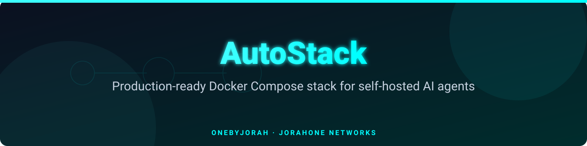
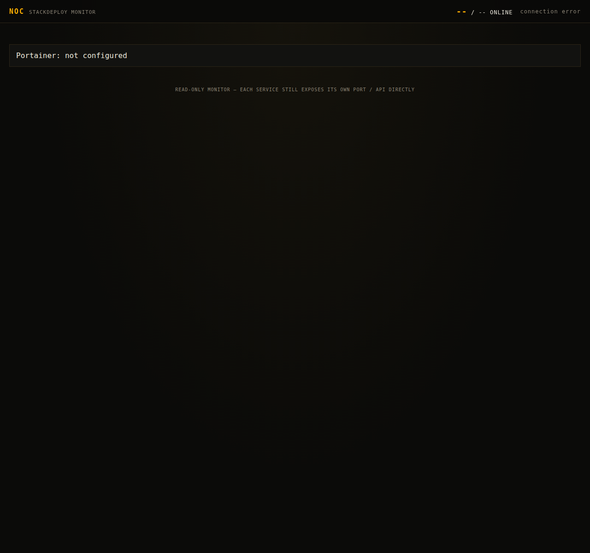

<div align="center">



# AutoStack

Production-ready Docker Compose stack for self-hosted AI agents


</div>

---

<p align="center">
  
</p>

<br>

---

## Features

- **One Command Deploy** — `docker compose up -d` and you're ready.
- **Search Engine** — SearXNG for private web search.
- **Long-Term Memory** — Honcho for persistent agent memory.
- **Browser Automation** — Selenium-based web automation (plus optional Camofox/CloakBrowser via [browser-search](browser-search/)).
- **Vector Storage** — Qdrant for embeddings.
- **Privacy-Focused** — All data stays on your infrastructure.
- **CPU-Only** — No GPU required.
- **Production Ready** — Health checks and monitoring.

## Quick Start

```bash
git clone https://github.com/OneByJorah/AutoStack.git
cd AutoStack

cp .env.example .env
docker compose up -d
```

### Access Services

| Service | URL |
|---------|-----|
| SearXNG | http://localhost:8080 |
| Qdrant | http://localhost:6333 (loopback by default) |
| Honcho API | http://localhost:8081 |
| Obsidian (vault UI) | http://localhost:8083 |
| WebAutomation (Selenium) | http://localhost:4444 |

Optional overlays add Portainer (`:9000`), Camofox (`:9377`), CloakBrowser CDP (`:9222`), Headroom (`:8787`), and the NOC Dashboard (`:9500`). See `docs/` and the `docker-compose.*.yml` overlay files.

## Stack Components

| Component | Purpose |
|-----------|---------|
| **SearXNG** | Privacy web search |
| **Qdrant** | Vector database |
| **Honcho** | Long-term memory (Postgres + Redis ship in the optional Honcho overlay) |
| **WebAutomation** | Selenium/Chrome browser automation |
| **Obsidian** | Caddy-served vault UI |

## Configuration

Key variables from `.env.example`:

| Variable | Default | Description |
|----------|---------|-------------|
| `HOST_IP` | `127.0.0.1` | Host IP used by Cloudflare Tunnel ingress and docs |
| `HONCHO_IMAGE` | `ghcr.io/onebyjorah/honcho:latest` | Honcho image |
| `HONCHO_DB_PASSWORD` | placeholder | Honcho Postgres password (Honcho overlay) |
| `OBSIDIAN_VAULT_PATH` | `/opt/autostack/ObsidianVault` | Host path to the Obsidian vault (compose fallback: `./obsidian`) |
| `QDRANT_BIND` | `127.0.0.1` | Bind address for the Qdrant port |
| `SELENIUM_VNC_BIND` | `127.0.0.1` | Bind address for the Selenium VNC port |

## Project Structure

```
AutoStack/
├── docker-compose.yml       # Main compose file (+ docker-compose.*.yml overlays)
├── .env.example             # Environment template
├── scripts/
│   ├── bootstrap.sh         # One-command deploy helper
│   ├── setup-wizard.sh      # Access-mode wizard
│   └── healthcheck.sh       # Service health checks
└── README.md
```

## Contributing

Contributions are welcome. Please see [CONTRIBUTING.md](CONTRIBUTING.md) for guidelines and [CODE_OF_CONDUCT.md](CODE_OF_CONDUCT.md) for community standards.

## Security

For security concerns, see [SECURITY.md](SECURITY.md). Found a vulnerability? Report privately to `security@jorahone.com` — do not use public issues.

## License

[MIT License](LICENSE) © Jhonattan L. Jimenez (OneByJorah)

---

<p align="center">Built with 🌴 by <a href="https://github.com/OneByJorah">OneByJorah</a> · <a href="https://jorahone.com">jorahone.com</a></p>
