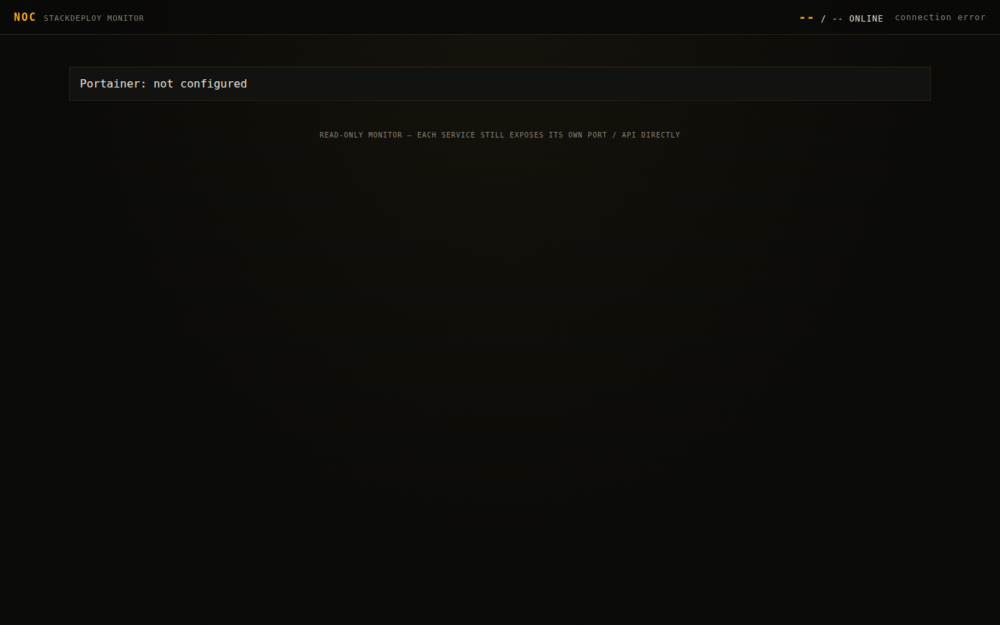
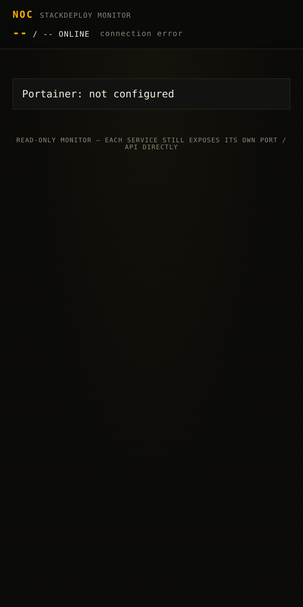

<div align="center">


# AutoStack

**Production-ready Docker Compose stack for self-hosted AI agents** — private search, vector storage, agent memory, and browser automation in one command.

<a href="https://github.com/OneByJorah/AutoStack/stargazers"></a>
<a href="https://github.com/OneByJorah/AutoStack/commits"></a>




</div>

## Quick Start

```bash
git clone https://github.com/OneByJorah/AutoStack.git
cd AutoStack
cp .env.example .env
docker compose up -d
```

Open **http://localhost:8080** for SearXNG. `install.sh` (Linux/macOS) and `install.ps1` (Windows) wrap the same flow with a Docker preflight check.

## What This Is

AutoStack deploys a CPU-only, privacy-first AI agent stack without hand-wiring a dozen containers. It bundles private web search, a vector database, long-term agent memory, a notes vault, and browser automation behind a single `docker compose up`, and keeps every byte on your own infrastructure. It is aimed at homelabbers, AI developers, and small teams who want agent infrastructure they can actually own.

## Features

- **One-command deploy** — `docker compose up -d` brings the whole stack online; no orchestration tooling required.
- **Private search** — SearXNG aggregates web search with no tracking or profiling.
- **Vector storage** — Qdrant stores embeddings for semantic search and retrieval.
- **Agent memory** — Honcho provides persistent, long-term memory for agents.
- **Browser automation** — Selenium standalone Chrome for scraping and web agents, with an optional Camofox stealth browser.
- **Notes vault** — an Obsidian-style vault served over the browser for shared notes.
- **CPU-only** — runs on any VPS, homelab box, or workstation; no GPU needed.
- **Composable overlays** — optional Honcho, Headroom, and Portainer compose files layer on top of the base stack.

## Services

| Service | Port | Purpose | Image |
|---------|------|---------|-------|
| **SearXNG** | `8080` | Privacy-respecting metasearch | `searxng/searxng` |
| **Qdrant** | `6333` | Vector database for embeddings | `qdrant/qdrant` |
| **Honcho** | `8081` | Long-term agent memory API | `ghcr.io/onebyjorah/honcho` |
| **Obsidian** | `8083` | Browser-served notes vault (Caddy) | `caddy:2-alpine` |
| **Selenium** | `4444` | Chrome browser automation (VNC `5900`) | `selenium/standalone-chrome` |

### Optional overlays

| Overlay | Adds | Command |
|---------|------|---------|
| `docker-compose.honcho.yml` | Honcho API + pgvector Postgres + Redis | `docker compose -f docker-compose.yml -f docker-compose.honcho.yml up -d` |
| `docker-compose.headroom.yml` | Headroom proxy, Qdrant, Neo4j | `docker compose -f docker-compose.yml -f docker-compose.headroom.yml up -d` |
| `docker-compose.portainer.yml` | Portainer container admin UI (`9000`, `9443`) | `docker compose -f docker-compose.yml -f docker-compose.portainer.yml up -d` |

## Architecture

```
                 ┌──────────────────────────────────────────┐
                 │                AutoStack                  │
                 │                                           │
  ┌──────────┐   │  ┌──────────┐  ┌──────────┐  ┌──────────┐ │
  │ AI agent │──▶│  │ SearXNG  │  │  Qdrant  │  │  Honcho  │ │
  │  / user  │   │  │  :8080   │  │  :6333   │  │  :8081   │ │
  └──────────┘   │  └──────────┘  └──────────┘  └──────────┘ │
                 │                                           │
                 │  ┌──────────┐  ┌──────────────────────┐   │
                 │  │ Obsidian │  │ Selenium (web auto)  │   │
                 │  │  :8083   │  │  :4444 / VNC :5900   │   │
                 │  └──────────┘  └──────────────────────┘   │
                 └──────────────────────────────────────────┘
```

All services run on a single host. Loopback binds are the default; see [SECURITY.md](SECURITY.md) before exposing ports on a LAN or tailnet.

## Configuration

Copy `.env.example` to `.env` and set real values. Key variables:

| Variable | Default | Description |
|----------|---------|-------------|
| `HOST_IP` | `127.0.0.1` | Host IP used by tunnel ingress and docs |
| `QDRANT_BIND` | `127.0.0.1` | Bind address for Qdrant (`0.0.0.0` to expose) |
| `OBSIDIAN_VAULT_PATH` | `/opt/autostack/ObsidianVault` | Host path mounted into the vault container |
| `HONCHO_DB_PASSWORD` | — | PostgreSQL password for the Honcho overlay |
| `HONCHO_TOKEN` | — | Honcho API auth token |
| `HONCHO_IMAGE` | `ghcr.io/onebyjorah/honcho:latest` | Honcho image reference |
| `OLLAMA_HOST` | `http://ollama:11434` | Optional local LLM endpoint |
| `OLLAMA_MODEL` | `llama3.2:3b` | Default model for local LLM features |
| `NOC_DASHBOARD_PORT` | `9500` | Port for the optional NOC dashboard overlay |
| `LOG_LEVEL` | `INFO` | Container log verbosity |

> [!WARNING]
> The base stack publishes several services without authentication. Bind to `127.0.0.1`, keep it behind a VPN/tailnet, or front it with an authenticated proxy before exposing it to any shared network.

## Use Cases

1. **AI developers** — spin up a local search + memory + vector stack for agent prototypes in minutes.
2. **Privacy advocates** — self-host search and memory instead of sending queries to cloud APIs.
3. **Homelabbers** — run a reproducible AI infrastructure baseline on modest, GPU-less hardware.
4. **MSPs and small teams** — stand up internal AI tooling without a managed platform bill.

## Tech Stack

Docker Compose, SearXNG, Qdrant, Honcho, Selenium (standalone Chrome), Caddy, PostgreSQL + pgvector, Redis, Neo4j.

## Screenshots

| View | Preview |
|------|---------|
| NOC dashboard |  |
| Full dashboard |  |
| Main viewport |  |
| Mobile |  |

## Project Structure

```
AutoStack/
├── docker-compose.yml             # Base stack
├── docker-compose.honcho.yml      # Optional Honcho overlay
├── docker-compose.headroom.yml    # Optional Headroom overlay
├── docker-compose.portainer.yml   # Optional Portainer overlay
├── .env.example
├── install.sh / install.ps1
├── searxng/                       # SearXNG configuration
├── honcho/                        # Honcho configuration
├── headroom/                      # Headroom configuration
├── noc-dashboard/                 # Optional NOC monitoring UI
├── profiles/                      # Compose profiles
├── obsidian-skills/               # Agent skills for Obsidian
├── docs/                          # Setup guides + assets
└── scripts/                       # Helper scripts
```

## Contributing

Contributions are welcome. Please read [CONTRIBUTING.md](CONTRIBUTING.md) and [CODE_OF_CONDUCT.md](CODE_OF_CONDUCT.md), then [open an issue](https://github.com/OneByJorah/AutoStack/issues) or a pull request.

## License

MIT — see [LICENSE](LICENSE).

## Connect

- [jorahone.com](https://jorahone.com)
- [GitHub Org](https://github.com/OneByJorah)
- [info@jorahone.com](mailto:info@jorahone.com)
