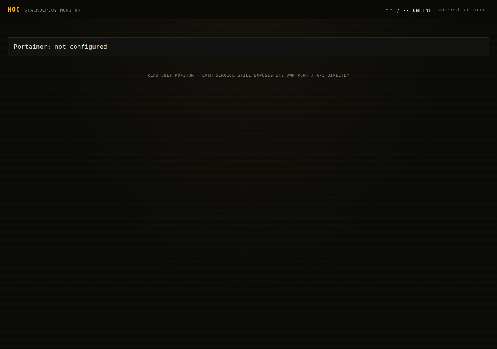
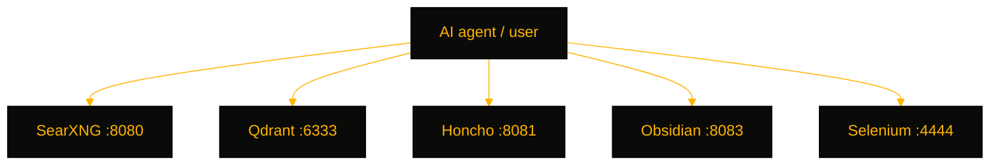

# AutoStack

> A CPU-only Docker Compose stack for self-hosted AI agent infrastructure — private search, vector storage, agent memory, and browser automation from one command.

[](https://github.com/OneByJorah/AutoStack)
[](https://github.com/OneByJorah/AutoStack)
[](https://github.com/OneByJorah/AutoStack/stargazers)
[](https://github.com/OneByJorah/AutoStack/commits)
[](https://github.com/OneByJorah/AutoStack/actions)



## What This Is

AutoStack deploys a privacy-first AI agent stack without hand-wiring a dozen containers. It bundles private web search, a vector database, long-term agent memory, a notes vault, and browser automation behind a single `docker compose up`, and keeps every byte on your own infrastructure. Aimed at homelabbers, AI developers, and small teams that want agent infrastructure they can actually own — no GPU required.

## Quick Start

```bash
git clone https://github.com/OneByJorah/AutoStack.git
cd AutoStack
cp .env.example .env
docker compose up -d
```

Open **http://localhost:8080** for SearXNG. `install.sh` (Linux/macOS) and `install.ps1` (Windows) run the same flow with a Docker preflight check.

## Features

- **One-command deploy** — `docker compose up -d` brings the whole stack online with healthchecks on every service.
- **Private search** — SearXNG aggregates web search with no tracking or profiling (`:8080`).
- **Vector storage** — Qdrant for embeddings and semantic retrieval (`:6333`).
- **Agent memory** — Honcho provides persistent, long-term memory for agents (`:8081`).
- **Browser automation** — Selenium standalone Chrome (`:4444`, VNC `:5900`) for scraping and web agents.
- **Notes vault** — Obsidian-style vault served over Caddy (`:8083`).
- **CPU-only** — runs on any VPS, homelab box, or workstation.
- **Composable overlays** — optional Honcho (pgvector + Redis), Headroom, and Portainer compose files layer on top of the base.

## Architecture



All services run on a single host. Base stack binds loopback by default — see [SECURITY.md](SECURITY.md) before exposing ports on a LAN or tailnet, and front anything public with an authenticated proxy.

## Stack

Docker Compose · SearXNG · Qdrant · Honcho (PostgreSQL + pgvector + Redis) · Selenium standalone Chrome · Caddy

## Contributing

See [CONTRIBUTING.md](CONTRIBUTING.md) and [CODE_OF_CONDUCT.md](CODE_OF_CONDUCT.md), then [open an issue](https://github.com/OneByJorah/AutoStack/issues) or a pull request.

## License

MIT — see [LICENSE](LICENSE).
